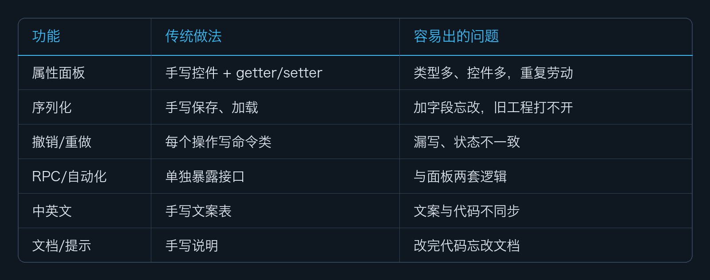
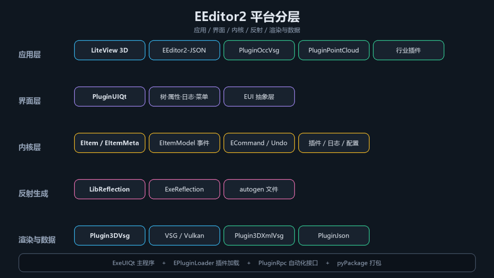
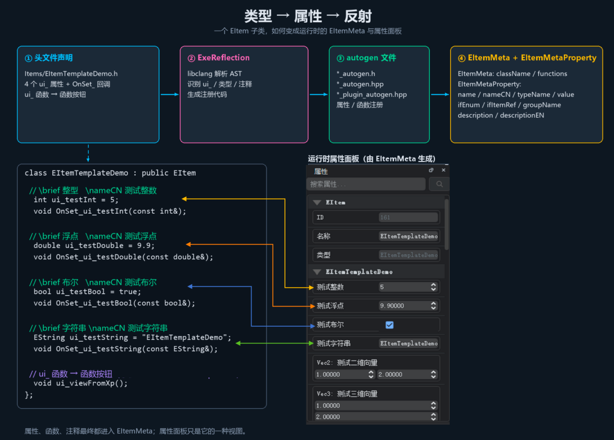
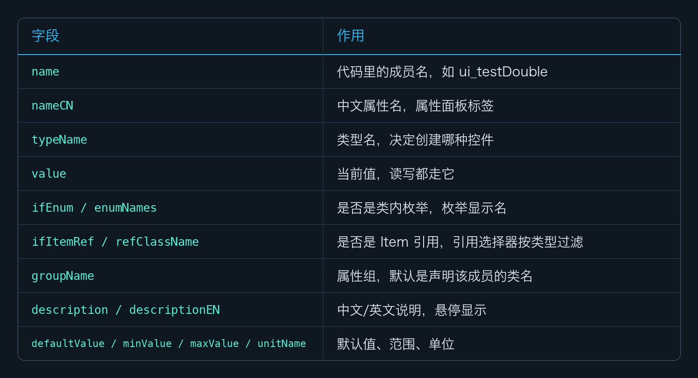
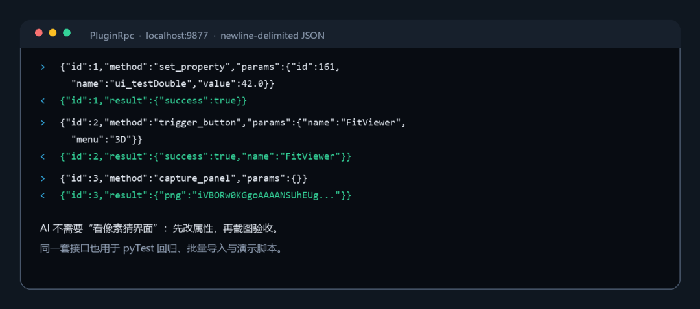
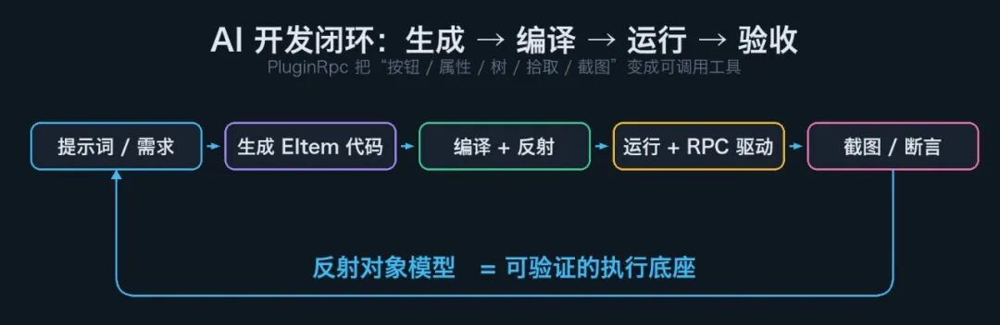

# EEditor-open

> 反射驱动的 C++ 专业软件开发平台 · 让专业软件"长"出来
> A reflection-driven C++ platform that lets professional software "grow"

[官网 / Website](https://eeditor.com.cn/) · [知乎介绍 / Zhihu](https://zhuanlan.zhihu.com/p/2106396925826167550) · [Gitee](https://gitee.com/eeditor/eeditor) · [GitHub](https://github.com/EEditor-Code/EEditor)

[中文](#zh) | [English](#en)

---

<a id="zh"></a>

## 中文

### 这是什么

EEditor 是一套面向大型专业软件的 C++ 开发底座。它用反射把对象模型、界面、序列化、撤销与 RPC 收敛到同一份元信息上，让不同产品共享同一个内核，通过插件组合"长"出来。

一个直观的例子：LiteView 3D（3DXML 浏览）与 EEditor-Json（JSON 查看/编辑）看起来是两个完全不同的产品，但底层跑的是同一套对象模型、同一套树/属性/日志/菜单、同一条撤销与序列化通道。

> 说明：文中描述的四层结构与完整能力属于 **EEditor 平台整体**。本仓库当前开源的是内核的**最小可编译版本**（里程碑 1：LibCommon 内核层），`LibReflection` / `ExeReflection` 等将在后续里程碑加入。

### 设计理念

传统 C++ 专业软件里，新增一个参数往往要改 6 处：

1. 在类里加成员变量；
2. 在属性面板里加控件、写读写回调；
3. 补序列化与反序列化；
4. 补撤销/重做；
5. 补 RPC 或脚本接口；
6. 更新中英文文档、提示与帮助。

六件事分散在六个地方，改一次参数名要全局搜索，漏一处就会出现"界面能改、保存丢值"这类隐蔽 bug。

EEditor 的出发点不是"少写代码"，而是把重复的代码逻辑收敛到对象模型里：

> 对象只描述"我有什么"，平台负责"怎么显示、怎么保存、怎么撤销、怎么被调用"。



### 平台公式与四层结构

> 反射 + 界面自动生成 + C++ 开源生态接入 + AI 驱动的开发流程 = 快速的专业软件开发平台



1. **应用层**：LiteView 3D、EEditor-Json。产品之间共享内核，差异主要体现在插件组合与界面配置上。
2. **界面层**：PluginUIQt 提供树、属性、日志、菜单、工具栏、Dock、对话框等 Qt 实现；Plugin3DVsg 提供基于 VSG/Vulkan 的 3D 视图、相机、拾取与操作器。
3. **内核层**：LibCommon 提供 `EItem` 对象模型、`EItemMeta` 元信息、`EItemModel` 事件、`ECommand` 撤销、插件加载、日志、配置、文件信息等基础设施；LibReflection 提供头文件解析与代码生成能力；ExeReflection 是面向 `Items/*.h` 的生成器。
4. **基础功能层**：直接复用成熟生态——VulkanSceneGraph、Qt、ImGui、Clang、OpenCASCADE、Scintilla 等，不重新发明轮子，而是把它们接进统一的对象模型。

这四层带来一个直接结果：**一份对象数据，可以同时出现在树、属性面板、3D 场景、序列化文件、撤销栈和 RPC 接口里。**

### 核心机制：类型 → 属性 → 反射

以类 `EItemTemplateDemo` 为例：类继承 `EItem`，需要暴露给界面的成员以 `ui_` 开头，并为每个属性声明 `OnSet_` 回调；注释里用 `\brief` 写中文说明、`\~english` 写英文说明、`\nameCN` 写中文属性名。

```cpp
class EItemTemplateDemo : public EItem
{
public:
    /*!
        \brief 浮点测试值。
        \~english Double test value.
        \nameCN 测试浮点
    */
    double ui_testDouble = 9.9;
    void OnSet_ui_testDouble(const double& value);

    // int / bool / EString 等同理
    // ...
};
```

ExeReflection 解析头文件后，为每个类生成三类文件：

```text
EXxx_autogen.h
EXxx_autogen.hpp
EXxx_plugin_autogen.hpp
```

里面是注册属性、绑定 getter/setter、写回默认值与类型的代码。插件在 `registThis()` 里调用生成的注册函数，`EItemMeta` 就被填充起来；属性面板、树、序列化、撤销、RPC 都从同一份元信息读取。



`EItemMetaProperty` 描述"这个属性是什么"，属性面板只是这些字段的一种视图：`double` 建数值框，`bool` 建复选框，类内枚举建下拉，`EColor` 建颜色按钮，`E...Ptr` 建 Item 引用选择器。



因为属性面板、树、序列化、撤销、RPC 都从同一个 `EItemMeta` / `EItem` 读取：

- 在面板改值、在 RPC 改值，走同一条属性通道；
- 属性变更产生统一的 `ItemChanged` 事件，树和属性面板同步刷新；
- 序列化遍历属性，不需要每个类手写保存/加载；
- 撤销栈记录属性旧值/新值，不需要每个操作写命令类。

### 让 AI 参与开发

EItem 提供的机制，使得利用 AI 写 C++ 代码来扩展平台功能变得简单。以增加 EItem 子类为例，推荐两步：

1. **让 AI 先读代码**：先让 AI 熟悉 `EItem` 的类定义和反射生成逻辑，从源码里读出规则，而不是靠猜。
2. **按需求生成子类**：给出类名、属性、类型、注释规范与函数按钮需求，并约定不要修改 `LibCommon` / `LibReflection`。

验收以**运行时可观察的行为**为准，而不是"编译成功"：

1. 编译；
2. 跑 ExeReflection 生成 autogen；
3. 启动应用；
4. 用 PluginRpc 改属性、读属性；
5. 截图属性面板；
6. 撤销/重做，保存/加载。

PluginRpc 在本机 `9877` 端口开一个 TCP 服务，用"一行一条 JSON"收发请求，覆盖对象与属性、界面操作、编辑操作、3D 与拾取、截图验证、国际化等能力。对 AI 来说，它不需要"看像素猜界面"，而是可以先读对象、改属性、点按钮，再截图做像素断言。



这就形成了一条闭环：提示词生成代码 → 编译与反射 → 运行 → RPC 驱动 → 截图/断言 → 反馈修正。



### 愿景

EEditor 更准确的定位是：

> **可被 AI 安全操作的专业软件底座。**

在这个底座上，一个插件就是一组能力：3D 查看、格式导入、点云处理、数字孪生、JSON 编辑。产品可以按行业组合，界面可以按客户定制，而内核保持一致。

### 目录结构

```text
EEditor-open/
├─ CMakeLists.txt              # 顶层构建入口
├─ LICENSE                     # LGPL-2.1 全文
├─ COPYING                     # GPL-2.0 全文（LGPL-2.1 要求随附）
├─ COPYING.LESSER              # LGPL-2.1 全文
├─ NOTICE                      # 版权与第三方声明
├─ docs/images/                # README 配图
└─ LibCommon/                  # 最小内核层（C++17，无 Qt/OSG 依赖）
   ├─ CMakeLists.txt
   ├─ EItem.*                  # 对象树基类
   ├─ EItemMeta.*              # 类元信息（属性/方法）
   ├─ EItemMetaProperty.*      # 属性元信息
   ├─ EItemMetaFunction.*      # 函数元信息
   ├─ EVariant.*               # 通用属性值
   ├─ EString.*                # 字符串别名与工具
   ├─ EVec2/3/4.* EMatrix4x4.* # 基础数学类型
   ├─ SmartPtr/                # 引用计数智能指针
   ├─ string/                  # pystring 工具
   └─ log/                     # 日志
```

### 快速开始

Windows：

```bash
cmake -S . -B build -G "Visual Studio 17 2022" -A x64
cmake --build build --config Release
```

Linux / macOS：

```bash
cmake -S . -B build
cmake --build build
```

产物：`build/bin/LibCommon.dll`（或 `lib/libCommon.so` / `libCommon.dylib`）。

### 路线图

- **里程碑 1（当前）**：LibCommon 最小可编译内核（EItem + 反射元数据 + 基础工具）。
- **里程碑 2**：LibReflection + ExeReflection（接回 autogen，恢复类型自动注册）。
- **里程碑 3**：ExeCommon 示例与单测。
- **后续**：插件化能力与更多平台模块。

> LiteView 3D / PluginUIQt / Plugin3DVsg / PluginRpc 等属于 EEditor 平台的完整能力，不在本仓库当前范围内。

### 相关链接

- 官网：https://eeditor.com.cn/
- 知乎介绍：https://zhuanlan.zhihu.com/p/2106396925826167550
- Gitee：https://gitee.com/eeditor/eeditor
- GitHub：https://github.com/EEditor-Code/EEditor

### 参考与致谢

本 README 的简介、设计理念、四层结构与示例整理自《EEditor：让专业软件"长"出来》（知乎，2026-11-17），版权归原作者所有。

### 许可

本仓库代码以 **GNU Lesser General Public License v2.1 or later**（LGPL-2.1-or-later）发布，版权归 **北京格瑞特皮软件科技有限公司** 所有。允许闭源软件以动态链接（DLL）方式使用本库；对库本身的修改需继续以 LGPL 发布。详见 `LICENSE`、`COPYING`、`COPYING.LESSER` 与 `NOTICE`。

---

<a id="en"></a>

## English

### What is EEditor

EEditor is a C++ foundation for building large professional software. Reflection turns each object's declared properties and functions into runtime metadata, and the same metadata drives the object tree, property panel, serialization, undo/redo and RPC. Products share one kernel and "grow" through plugin composition.

A concrete example: LiteView 3D (a 3DXML viewer) and EEditor-Json (a JSON viewer/editor) look like two completely different products, yet they run on the same object model, the same tree/property/log/menu infrastructure, and the same undo and serialization pipeline.

> Note: the four-layer architecture and full capabilities described below belong to the **EEditor platform as a whole**. This repository currently contains the **minimal compilable kernel** (Milestone 1: LibCommon). `LibReflection` / `ExeReflection` will arrive in later milestones.

### Design philosophy

In a typical C++ professional application, adding one parameter touches six places:

1. a member variable in the class;
2. a property-panel widget with get/set callbacks;
3. serialization and deserialization;
4. undo/redo;
5. an RPC or scripting interface;
6. bilingual documentation and help.

These six tasks are scattered across six places. Renaming a parameter requires a global search, and missing one place leads to subtle bugs such as "the UI edits it, but saving loses the value".

EEditor does not aim to "write less code"; it converges the repetitive logic into the object model:

> An object only describes "what it has"; the platform decides how it is displayed, saved, undone and invoked.


### Formula and four layers

> Reflection + automatic UI + C++ open-source ecosystem + AI-driven workflow = a fast professional-software platform


1. **Application layer**: LiteView 3D and EEditor-Json. Products share the kernel; their differences are mainly plugin composition and UI configuration.
2. **UI layer**: PluginUIQt provides Qt-based trees, properties, logs, menus, toolbars, docks and dialogs; Plugin3DVsg provides a VSG/Vulkan 3D view with camera, picking and manipulators.
3. **Kernel layer**: LibCommon provides the `EItem` object model, `EItemMeta` metadata, `EItemModel` events, `ECommand` undo/redo, plugin loading, logging, configuration and file information; LibReflection provides header parsing and code generation; ExeReflection is the generator for `Items/*.h`.
4. **Foundation layer**: mature ecosystems are reused directly — VulkanSceneGraph, Qt, ImGui, Clang, OpenCASCADE, Scintilla — instead of reinventing wheels.

The result: **one piece of object data can appear simultaneously in the tree, property panel, 3D scene, serialized file, undo stack and RPC interface.**

### Type → property → reflection

Take `EItemTemplateDemo` as an example: inherit `EItem`, prefix members exposed to the UI with `ui_`, and declare an `OnSet_` callback for each property. Use `\brief` for the Chinese description, `\~english` for the English description, and `\nameCN` for the Chinese property name.

```cpp
class EItemTemplateDemo : public EItem
{
public:
    /*!
        \brief 浮点测试值。
        \~english Double test value.
        \nameCN 测试浮点
    */
    double ui_testDouble = 9.9;
    void OnSet_ui_testDouble(const double& value);

    // int / bool / EString and so on follow the same pattern
    // ...
};
```

ExeReflection parses the header and generates three files per class:

```text
EXxx_autogen.h
EXxx_autogen.hpp
EXxx_plugin_autogen.hpp
```

They contain code that registers properties, binds getters/setters, and writes back default values and types. A plugin calls the generated registration function in `registThis()`, which populates `EItemMeta`. The property panel, tree, serialization, undo/redo and RPC all read the same metadata.


`EItemMetaProperty` describes "what this property is". The property panel is just one view of these fields: `double` becomes a numeric editor, `bool` a checkbox, an in-class enum a combo box, `EColor` a color button, and `E...Ptr` an item-reference picker.


Because the property panel, tree, serialization, undo/redo and RPC all read the same `EItemMeta` / `EItem`:

- editing in the panel or via RPC goes through the same property channel;
- a property change emits a unified `ItemChanged` event, so the tree and panel refresh together;
- serialization walks properties, so each class does not need hand-written save/load;
- the undo stack records old/new property values, so each operation does not need a command class.

### AI-assisted development

The EItem mechanism makes it easy to extend the platform with AI-generated C++. To add an EItem subclass, two steps are recommended:

1. **Let the AI read the code first**: have it study the `EItem` class definition and the reflection generation rules, so it reads the rules from source rather than guessing.
2. **Generate the subclass from requirements**: provide the class name, properties, types, comment conventions and function-button needs, and require that `LibCommon` / `LibReflection` are not modified.

Acceptance is based on **observable runtime behavior**, not merely "it compiles":

1. build;
2. run ExeReflection to generate autogen;
3. launch the application;
4. get/set properties through PluginRpc;
5. capture the property panel;
6. undo/redo, save/load.

PluginRpc opens a TCP service on local port `9877` and exchanges one JSON request per line. It covers objects and properties, UI operations, editing, 3D picking, screenshot verification and i18n. For an AI, this means it can inspect objects, set properties and click buttons instead of guessing from pixels, then capture screenshots for pixel assertions.


This forms a closed loop: prompt-generated code → build and reflection → run → RPC-driven interaction → screenshot/assertion → feedback and fix.


### Vision

A more precise positioning for EEditor:

> **A professional-software foundation that AI can operate safely.**

On this foundation, a plugin is a capability: 3D viewing, format import, point-cloud processing, digital twins, JSON editing. Products can be composed per industry and UIs customized per customer, while the kernel stays consistent.

### Repository layout

```text
EEditor-open/
├─ CMakeLists.txt              # top-level build entry
├─ LICENSE                     # LGPL-2.1 full text
├─ COPYING                     # GPL-2.0 full text (required by LGPL-2.1)
├─ COPYING.LESSER              # LGPL-2.1 full text
├─ NOTICE                      # copyright and third-party notices
├─ docs/images/                # README images
└─ LibCommon/                  # minimal kernel (C++17, no Qt/OSG dependency)
   ├─ CMakeLists.txt
   ├─ EItem.*                  # object-tree base class
   ├─ EItemMeta.*              # class metadata (properties/functions)
   ├─ EItemMetaProperty.*      # property metadata
   ├─ EItemMetaFunction.*      # function metadata
   ├─ EVariant.*               # generic property value
   ├─ EString.*                # string alias and utilities
   ├─ EVec2/3/4.* EMatrix4x4.* # basic math types
   ├─ SmartPtr/                # reference-counted smart pointer
   ├─ string/                  # pystring utilities
   └─ log/                     # logging
```

### Quick start

Windows:

```bash
cmake -S . -B build -G "Visual Studio 17 2022" -A x64
cmake --build build --config Release
```

Linux / macOS:

```bash
cmake -S . -B build
cmake --build build
```

Output: `build/bin/LibCommon.dll` (or `lib/libCommon.so` / `libCommon.dylib`).

### Roadmap

- **Milestone 1 (current)**: minimal compilable LibCommon kernel (EItem + reflection metadata + basic utilities).
- **Milestone 2**: LibReflection + ExeReflection (restore autogen-based type registration).
- **Milestone 3**: ExeCommon examples and unit tests.
- **Later**: plugin capabilities and more platform modules.

> LiteView 3D / PluginUIQt / Plugin3DVsg / PluginRpc and other capabilities belong to the full EEditor platform and are not part of this repository yet.

### Links

- Website: https://eeditor.com.cn/
- Zhihu article: https://zhuanlan.zhihu.com/p/2106396925826167550
- Gitee: https://gitee.com/eeditor/eeditor
- GitHub: https://github.com/EEditor-Code/EEditor

### Acknowledgements

The introduction, design philosophy, four-layer architecture and examples in this README are adapted from "EEditor: Let Professional Software Grow" (Zhihu, 2026-11-17). Copyright belongs to the original author.

### License

This repository is released under the **GNU Lesser General Public License v2.1 or later** (LGPL-2.1-or-later). Copyright (C) 2026 **Beijing Great Pi Software Technology Co., Ltd.** Proprietary software may use this library via dynamic linking (DLL); modifications to the library itself must remain under the LGPL. See `LICENSE`, `COPYING`, `COPYING.LESSER` and `NOTICE`.
